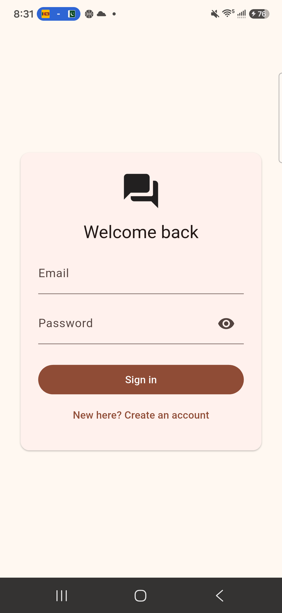
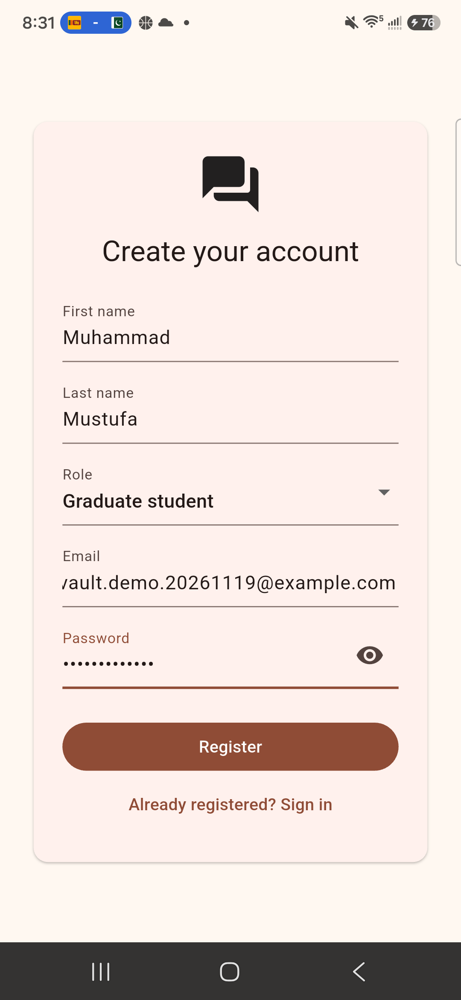
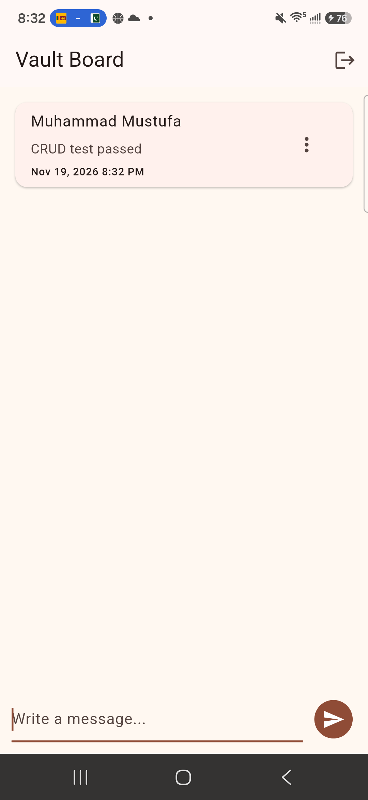
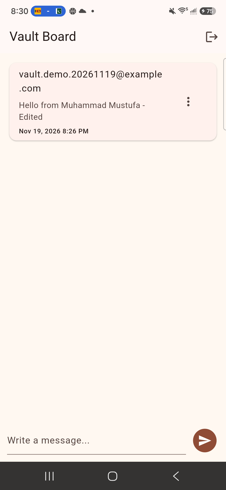
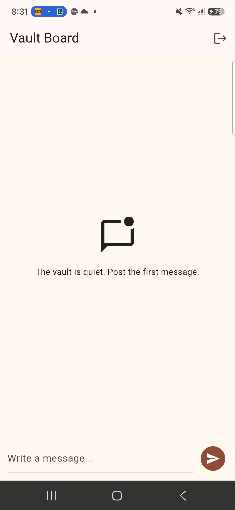
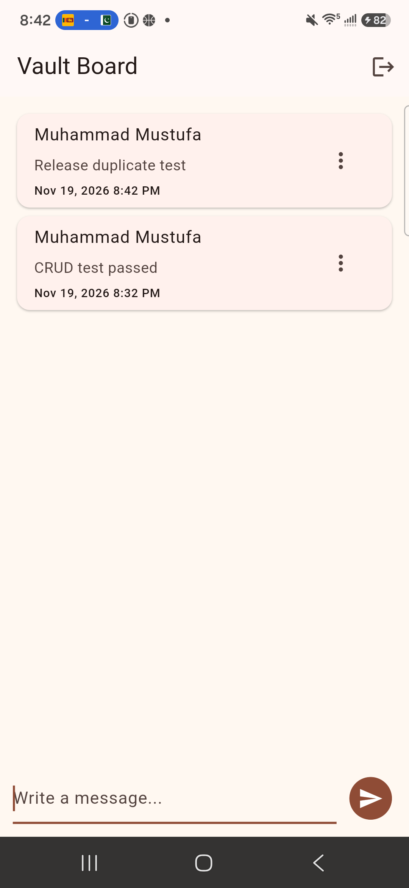

# Homework 02 — Message Board Vault Hunt

**Student:** Muhammad Mustufa  
**Track:** Graduate  
**Test date:** November 19, 2026  
**Device:** Samsung SM-S731U1, Android 17/API 37  
**Firebase project:** `message-board-vault-mustufa-26`  
**APK:** `app-release.apk`, 52,251,777 bytes  
**Repository URL:** _Add the public GitHub URL before submission._

## Executive result

The app implements splash/error initialization, Firebase Email/Password Authentication, an auth-state gate, a five-field private user document, real-time Firestore message reads, owner-only CRUD, server timestamps, schema v2, idempotent creation, deployed security rules, and emulator automation. Flutter analysis and widget tests pass. The combined emulator run reports five passed and zero failed. The exact release APK installed and launched on the named phone; release create/read and rapid-double-submit passed. Debug-device CRUD had already passed. The release edit/delete automation was not counted as complete because keyboard positioning prevented a reliable final delete observation; this is reported rather than inferred.

## Architecture and authorization judgment

Authentication proves identity through Firebase Auth. Authorization decides access through Firestore Security Rules. `AuthGate` routes the UI, but a REST client can ignore that UI; therefore rules bind `authorUid` to `request.auth.uid`, keep ownership immutable, and check the stored owner for edit/delete. Public board content is separated from private `users/{uid}` documents. The full field map and trade-offs are in the README.

## Prioritized test matrix

| Priority | Test | Expected | Observed | Result/evidence |
|---|---|---|---|---|
| P0 | Release APK install/launch | Exact APK installs and opens | Installed via ADB; authenticated board opened | PASS |
| P0 | Registration | Auth user plus five-field profile | Muhammad Mustufa registered; board opened | PASS, Fig. 2 |
| P0 | Auth persistence | Relaunch restores signed-in route | Relaunch returned directly to board | PASS |
| P0 | Create/read | One post appears through stream | Post appeared without refresh | PASS, Fig. 4 |
| P0 | Edit | Owned text changes | Debug device edit persisted after relaunch | PASS, Fig. 5 |
| P0 | Delete one | Target disappears; other data unaffected | Debug target disappeared and empty state returned | PASS, Fig. 6 |
| P0 | Signed-out read | Firestore rejects | Emulator `assertFails` passed | PASS |
| P0 | Cross-UID edit/delete | Firestore rejects both | Emulator `assertFails` passed | PASS |
| P0 | Forged author create | Firestore rejects | Emulator `assertFails` passed | PASS |
| P0 | Correct-author CRUD | All four operations allowed | Emulator test passed | PASS |
| P0 | Duplicate submit | Rapid double-tap leaves one document | Release UI contained exactly one matching message | PASS, Fig. 7 |
| P1 | Schema migration | v1 becomes v2 without loss | First run migrated 1; rerun migrated 0; deep equality passed | PASS |
| P1 | Initialization failure | Safe retry screen | Widget test passed | PASS |
| P1 | Second-client live update | First client updates without refresh | Not captured with two simultaneous physical/window clients | NOT RUN |
| P1 | Exact release edit/delete | Both operations work on release | Automation could not reliably complete final keyboard-driven sequence | INCOMPLETE |

## Screenshot evidence

### Figure 1 — Sign-in screen

**Action:** Launch while signed out. **Expected:** protected board is unavailable. **Observed:** sign-in form shown. **Result:** PASS.

### Figure 2 — Graduate demo registration

**Action:** Enter Muhammad Mustufa, graduate role, disposable email, and obscured password. **Expected:** validated five-field registration input. **Observed:** form accepted the values; subsequent registration opened the board. **Result:** PASS.

### Figure 3 — Intentional empty state

**Action:** Delete the only message. **Expected:** an intentional empty-board prompt, not a blank list. **Observed:** empty prompt rendered through the stream. **Result:** PASS.

### Figure 4 — Create/read through live stream

**Action:** Post `CRUD test passed`. **Expected:** server-backed document appears without refresh. **Observed:** message rendered with author and server time. **Result:** PASS.

### Figure 5 — Owned edit

**Action:** Edit the owned demo message. **Expected:** same document displays revised text. **Observed:** revised text persisted after app relaunch. **Result:** PASS.

### Figure 6 — Owned delete

**Action:** Confirm deletion. **Expected:** target disappears and stream rerenders. **Observed:** empty state returned without refresh. **Result:** PASS.

### Figure 7 — Release duplicate-submit test

**Action:** Rapidly tap Send twice on the installed release APK. **Expected:** one deterministic document. **Observed:** accessibility hierarchy contained exactly one `Release duplicate test`. **Result:** PASS.

## Required Main Spice — Release Readiness Gate

The exact `submission/app-release.apk` was built, installed, and launched on the Samsung device. Auth persistence, board read, create, and duplicate-submit passed. Rules denials are independently proven by emulator tests. Debug-device full CRUD passed. A true two-client live-stream capture and a reliable exact-release edit/delete replay remain incomplete, so the Main Spice must not be marked fully complete until those two observations are captured.

## Four graduate choice spices

1. **Emulator Explorer:** The test commands use `demo-vault-board`, and Firebase CLI states that attempts to access non-emulated services fail. Production was therefore untouched. PASS.
2. **Rules Unit Tester:** Four required rule scenarios plus cross-user delete run using `@firebase/rules-unit-testing`; combined output was five total tests, zero failures. PASS.
3. **Idempotent Alchemist:** UI guarding plus a deterministic UUID document ID and transaction converge retries. Release rapid double-tap produced one message. PASS.
4. **Schema Shape-shifter:** A realistic v1 document was seeded programmatically, migrated losslessly to v2, and a second run changed zero documents. PASS.

## AI design review and evidence challenge

**Prediction before implementation:** Auth state would be a routing signal, not an authorization mechanism; a stream would update the board automatically; ownership must be enforced by rules; and a transaction/deterministic ID would handle duplicate retries better than disabling a button alone. I expected controllers could be disposed immediately after `showDialog` returned.

**Tool and date:** OpenAI Codex, November 19, 2026. AI assistance was used for implementation scaffolding, test design, documentation structure, and review. No private credentials or service-account keys were supplied.

**Useful suggestions retained:** centralize Firebase calls in services, bind writes to UID in rules, use `snapshots()` for the board, use server timestamps, automate denial tests, and version message documents.

**Claim corrected by experiment:** the generated edit-dialog code disposed its `TextEditingController` immediately after `showDialog` completed. On the real device, Flutter asserted that dependents still existed during route dismissal. The Flutter API says to dispose a controller when it is no longer needed; the experiment showed that `Navigator.pop` completion was earlier than the reverse animation's full detach. The revised code waits one theme animation duration before disposal. This was committed separately and verified after reinstall. This is a device-layer omission that cloud-only tests would not catch.

**Cloud-layer verification:** Firebase documents that `authStateChanges()` fires initially and on sign-in/sign-out, but that does not make it authorization. Emulator experiments proved raw signed-in cross-UID writes were denied only because of rules. Firebase also documents that transactions are atomic, retry under contention, and fail offline; therefore the final design keeps UI state changes outside the transaction and reports failures safely.

**Sources:** [Firebase Auth state](https://firebase.google.com/docs/auth/flutter/start), [Firestore listeners](https://firebase.google.com/docs/firestore/query-data/listen), [Firestore transactions](https://firebase.google.com/docs/firestore/manage-data/transactions), [Flutter controller lifecycle](https://api.flutter.dev/flutter/widgets/TextEditingController-class.html).

## Critical Thinking Case Files

### Case 1 — The Ghost Editor

The demos passed because testers exercised only friendly UI paths. Hiding buttons is not authorization: a signed-in attacker could call Firestore directly and the tutorial rule allowed every write. The fix is to require `request.resource.data.authorUid == request.auth.uid` on create, preserve that field on update, and require `resource.data.authorUid == request.auth.uid` for update/delete. The trade-off is that legitimate moderation now needs a separately designed trusted role rather than an unrestricted client role. Automated tests with an attacker UID prove cross-user update/delete fail while the owner succeeds.

### Case 2 — The Runaway Dupes

Firestore can queue local writes and synchronize after reconnect, so disabling a button only prevents simultaneous taps in the current widget instance; it does not give a retried business operation a stable identity. For a two-person team, I would ship a deterministic operation ID with transaction-based existence checking plus the button guard. The residual risk is a caller incorrectly generating a new operation ID for what is logically the same retry. The experiment is to double-tap rapidly and repeat after a simulated retry with the same ID, then query/count matching documents. The release rapid double-tap produced one.

### Case 3 — The Stream That Would Not Stop

Each uncancelled snapshots subscription continues receiving events and can generate reads even when another route covers it. A `StreamBuilder` cancels its subscription when disposed, but pushed routes may leave the previous route mounted; manually created listeners must also be cancelled. I would first enforce cancel-on-dispose and use one shared repository stream if multiple mounted screens need the same board. The trade-off is added repository/state-management complexity. Prove the leak by logging listener creation/cancellation and comparing Firestore read metrics after repeated navigation; active listener count should return to baseline.

## Reflection

### 1. Expectation versus obtained result

I expected Firestore CRUD and the stream to work once rules were deployed. Create/read/delete did. The first automated edit test exposed a Flutter assertion during dialog dismissal, even though the Firestore design was correct. The obtained result showed that full-stack correctness includes widget lifecycle, not only database calls.

### 1a. Root cause and lesson

The controller was disposed before the reverse route animation detached its dependents. The lesson is to test destructive and modal flows on the shipped platform and treat lifecycle timing as part of robustness engineering.

### 2. Debug evidence

The red assertion screen identified `_dependents.isEmpty`. After delaying disposal until after the theme animation, `flutter analyze` and widget tests passed, the rebuilt APK installed, the edit persisted, and relaunch displayed the edited value.

### 2a. Alternative considered

I considered never disposing the controller. That avoids the assertion but leaks resources over repeated edits. Waiting until the dialog is actually detached preserves cleanup with a small, explicit delay.

### 3. Improvement plan

Add cursor pagination for history and keep only a small recent-message live listener. This controls initial reads and memory at 100,000 messages while preserving real-time behavior where users notice it.

### 4. Privacy and placement

The app deliberately keeps message content, profile fields, and credentials out of application-managed local storage. Firebase retains a native session token for convenience; the trade-off is that anyone with an unlocked device may inherit the session, mitigated by explicit sign-out and device security.

### 5. Cloud versus device

Messages and profiles belong in Firestore because they must survive devices and support live collaboration. A future unsent draft could remain on-device because it is private, temporary, and need not create reads. The Firebase session token blurs the boundary: identity state is locally persisted but represents cloud authority and must still be checked by server rules.

### 6. Scale and maintainability

The first failure at 100,000 messages would be read cost and initial stream size, not the simple ownership rule. The current query caps results at 100, but a production design should use cursor pagination for history, a small live recent window, shared streams where appropriate, and the existing automated rules suite in CI.

## Submission checklist

- [x] Source organized in meaningful commits
- [x] README with architecture, setup, data model, tests, and trade-offs
- [x] Release APK built and installed
- [x] Flutter analysis/tests and emulator rules/migration tests pass
- [x] Four choice spices implemented
- [ ] Add public GitHub repository URL
- [ ] Capture Firestore Console user-document screenshot
- [ ] Capture true second-client live-stream evidence
- [ ] Repeat/capture exact-release edit/delete reliably
- [ ] Convert this draft to DOCX/PDF and perform personal-authorship review
- [ ] Upload artifacts and verify LMS confirmation
